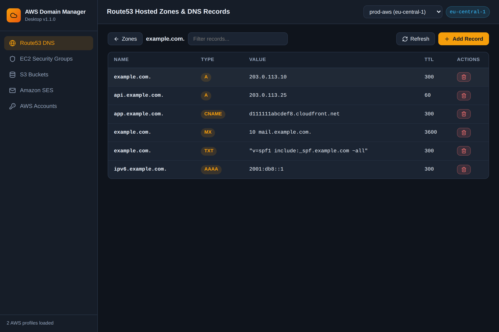
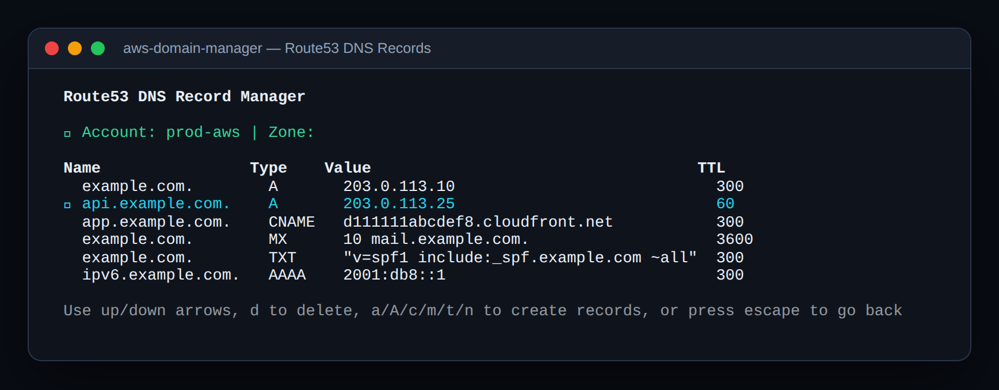
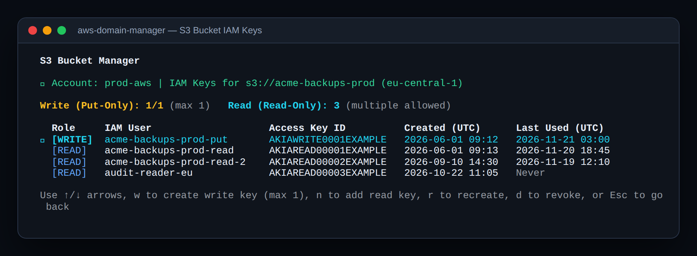
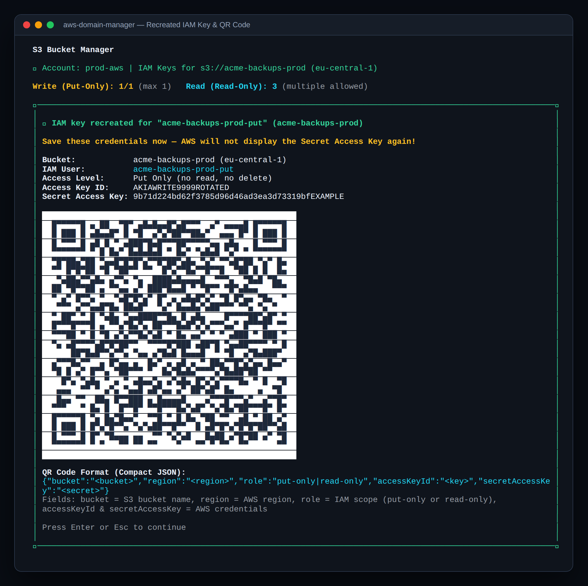

# AWS Domain Manager

[](https://github.com/sebseb7/awsDomainManager/actions/workflows/ci.yml)
[](https://github.com/sebseb7/awsDomainManager/actions/workflows/release.yml)

A terminal-based and native desktop UI tool for managing AWS Route53, EC2 Security Groups, S3 Buckets (with scoped IAM key management), Amazon SES Identities (domains & email addresses), and AWS credential profiles across multiple accounts.

## Screenshots

### Desktop App (Tauri v2)

| Route53 DNS Records | EC2 Security Groups |
| :---: | :---: |
|  |  |

| S3 Bucket IAM Keys (Single Write + Multiple Read) | Recreated IAM Key & QR Code |
| :---: | :---: |
|  |  |

| Amazon SES Identities (Domains & Email Addresses) | AWS Accounts & Minimum IAM Permissions Guide |
| :---: | :---: |
|  |  |

### Terminal UI (TUI)

| Route53 DNS Records | S3 Bucket IAM Keys |
| :---: | :---: |
|  |  |

| Amazon SES Identities | Recreated IAM Key & Terminal QR Code |
| :---: | :---: |
|  |  |

> Screenshots are generated automatically with dummy data by running `npm test` (Playwright + Ink).

## Usage

### Desktop App (Tauri v2)

Download the pre-built macOS (`.dmg` / `.app.zip`) or Windows (`.exe`) installer from [GitHub Releases](https://github.com/sebseb7/awsDomainManager/releases), or run locally from source:

```bash
cd desktop && npm install && npm run tauri dev
```

### Terminal UI (CLI)

```bash
npm i . && npm run build && npm run start
```

## Features

- **Route53 DNS Records** — Manage A/AAAA/CNAME/MX/TXT/NS records across hosted zones
- **EC2 Security Groups** — View, add, and delete inbound rules for security groups
- **S3 Buckets** — List, create (with optional scoped Put-Only and/or Read-Only IAM user creation — never delete — plus a scannable QR code of bucket & credentials), and delete S3 buckets; manage per-bucket IAM keys (revoke/recreate read & write keys, multiple read keys allowed, max 1 write key per bucket); and browse prefixes/folders to upload, download, or delete objects
- **Amazon SES Identities** — List, filter, add, and delete domain and email address identities with verification, DKIM, and sending status
- **AWS Account Management** — Add, edit, and remove AWS credential profiles (`~/.aws/credentials` and `~/.aws/config`) directly from the tool
- Terminal UI with keyboard navigation
- Support for AWS credential profiles
- Interactive resource creation

## Navigation

```
Resource Selection
  ├── Route53 Hosted Zones
  │     ├── Select account
  │     ├── Select hosted zone
  │     └── View/manage DNS records (a/A/c/m/t/n to add, d to delete)
  │
  ├── EC2 Security Groups
  │     ├── Select account
  │     ├── Select security group
  │     └── View/manage inbound rules (a to add, d to delete)
  │
  ├── S3 Buckets
  │     ├── Select account
  │     ├── View/create/delete buckets (a to create, d to delete, Enter to browse)
  │     └── Browse/manage bucket objects (Enter to open folder, u to upload, g to download, d to delete)
  │
  └── Manage AWS Accounts
        └── View/add/edit/remove AWS profiles (a to add, e/Enter to edit, d to remove)
```

### Key Bindings

| Key | Route53 Records | EC2 Rules | S3 Buckets | S3 Objects | Manage AWS Accounts |
|-----|----------------|-----------|------------|------------|---------------------|
| `↑/↓` | Navigate list | Navigate list | Navigate list | Navigate list | Navigate list |
| `Enter` | Select | Select | Browse bucket | Open folder | Edit selected account |
| `a` | Add A record | Add inbound rule | Create bucket | — | Add AWS account |
| `A` | Add AAAA record | — | — | — | — |
| `c` | Add CNAME record | — | — | — | — |
| `e` | — | — | — | — | Edit selected account |
| `g` | — | — | — | Download file | — |
| `m` | Add MX record | — | — | — | — |
| `t` | Add TXT record | — | — | — | — |
| `n` | Add NS record | — | — | — | — |
| `u` | — | — | — | Upload file | — |
| `d` | Delete selected | Delete selected rule | Delete bucket | Delete object | Remove selected account |
| `Esc` | Go back | Go back | Go back | Up folder / back | Go back |

## Requirements

- Node.js 18+
- AWS credentials configured in `~/.aws/credentials` (or add them via **Manage AWS Accounts**)
- AWS region configured in `~/.aws/config` (EC2 and S3 are region-specific)

## Minimum IAM Permissions (Least Privilege)

Create a dedicated IAM user for this tool instead of using root or `AdministratorAccess` credentials. Attach only the statements below for the features you plan to use (you can omit any statement for a service you do not use):

```json
{
  "Version": "2012-10-17",
  "Statement": [
    {
      "Sid": "Route53ListHostedZones",
      "Effect": "Allow",
      "Action": [
        "route53:ListHostedZones"
      ],
      "Resource": "*"
    },
    {
      "Sid": "Route53ManageRecords",
      "Effect": "Allow",
      "Action": [
        "route53:ListResourceRecordSets",
        "route53:ChangeResourceRecordSets"
      ],
      "Resource": "arn:aws:route53:::hostedzone/*"
    },
    {
      "Sid": "EC2SecurityGroupRules",
      "Effect": "Allow",
      "Action": [
        "ec2:DescribeSecurityGroups",
        "ec2:DescribeSecurityGroupRules",
        "ec2:AuthorizeSecurityGroupIngress",
        "ec2:RevokeSecurityGroupIngress"
      ],
      "Resource": "*"
    },
    {
      "Sid": "S3ListBuckets",
      "Effect": "Allow",
      "Action": [
        "s3:ListAllMyBuckets"
      ],
      "Resource": "*"
    },
    {
      "Sid": "S3ManageBucketsAndObjects",
      "Effect": "Allow",
      "Action": [
        "s3:CreateBucket",
        "s3:DeleteBucket",
        "s3:GetBucketLocation",
        "s3:ListBucket",
        "s3:GetObject",
        "s3:PutObject",
        "s3:DeleteObject"
      ],
      "Resource": [
        "arn:aws:s3:::*",
        "arn:aws:s3:::*/*"
      ]
    },
    {
      "Sid": "IAMListBucketUsers",
      "Effect": "Allow",
      "Action": [
        "iam:ListUsers"
      ],
      "Resource": "*"
    },
    {
      "Sid": "IAMManageBucketUsersOnly",
      "Effect": "Allow",
      "Action": [
        "iam:GetUser",
        "iam:ListUserTags",
        "iam:CreateUser",
        "iam:DeleteUser",
        "iam:TagUser",
        "iam:PutUserPolicy",
        "iam:ListUserPolicies",
        "iam:DeleteUserPolicy",
        "iam:CreateAccessKey",
        "iam:ListAccessKeys",
        "iam:DeleteAccessKey",
        "iam:GetAccessKeyLastUsed"
      ],
      "Resource": "arn:aws:iam::*:user/s3-bucket-users/*"
    },
    {
      "Sid": "SESListIdentities",
      "Effect": "Allow",
      "Action": [
        "ses:ListEmailIdentities",
        "ses:ListIdentities"
      ],
      "Resource": "*"
    },
    {
      "Sid": "SESManageIdentities",
      "Effect": "Allow",
      "Action": [
        "ses:GetEmailIdentity",
        "ses:GetIdentityVerificationAttributes",
        "ses:GetIdentityDkimAttributes",
        "ses:CreateEmailIdentity",
        "ses:DeleteEmailIdentity",
        "ses:VerifyDomainIdentity",
        "ses:VerifyDomainDkim",
        "ses:VerifyEmailIdentity",
        "ses:DeleteIdentity"
      ],
      "Resource": "*"
    }
  ]
}
```

### Locking down permissions further

- **IAM bucket-user isolation**: All optional IAM users created when creating an S3 bucket are placed under the `/s3-bucket-users/` path (`arn:aws:iam::<account-id>:user/s3-bucket-users/<username>`). The `IAMCreateBucketUsersOnly` statement above ensures this tool's user cannot touch any other IAM users in your account. Omit this statement completely if you don't create per-bucket IAM users.
- **Scoped Route53 / S3 resources**: Replace `arn:aws:route53:::hostedzone/*` with specific hosted zone IDs, or `arn:aws:s3:::*` with specific bucket name patterns (e.g. `arn:aws:s3:::my-prefix-*`).
- **Read-only usage**: Remove `ChangeResourceRecordSets`, `AuthorizeSecurityGroupIngress`, `RevokeSecurityGroupIngress`, `CreateBucket`, `DeleteBucket`, `PutObject`, `DeleteObject`, and the `IAMCreateBucketUsersOnly` statement if you only need read/view access.
