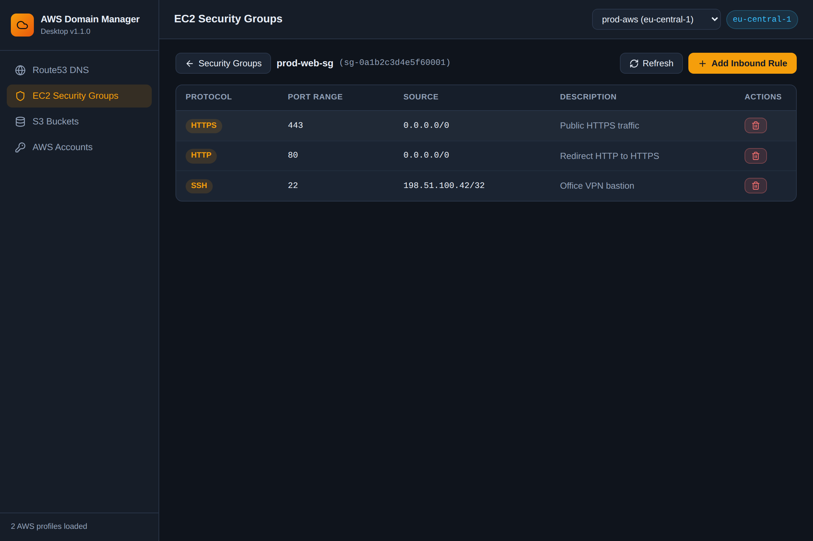
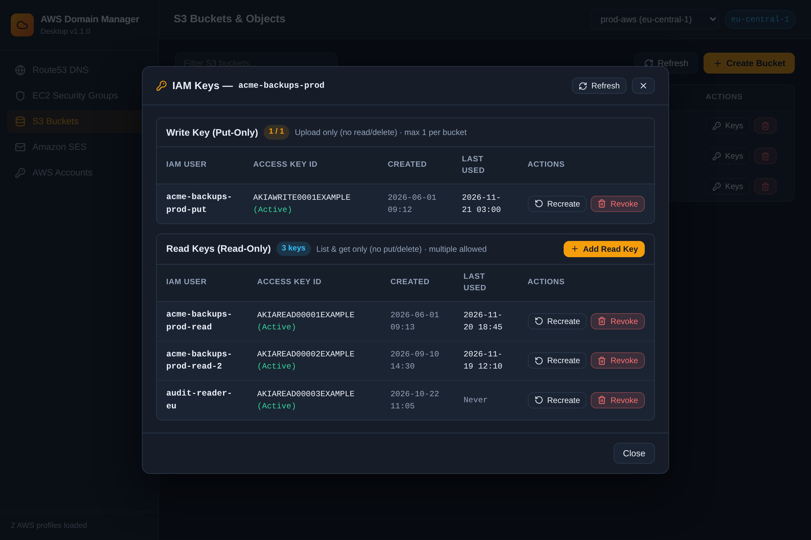
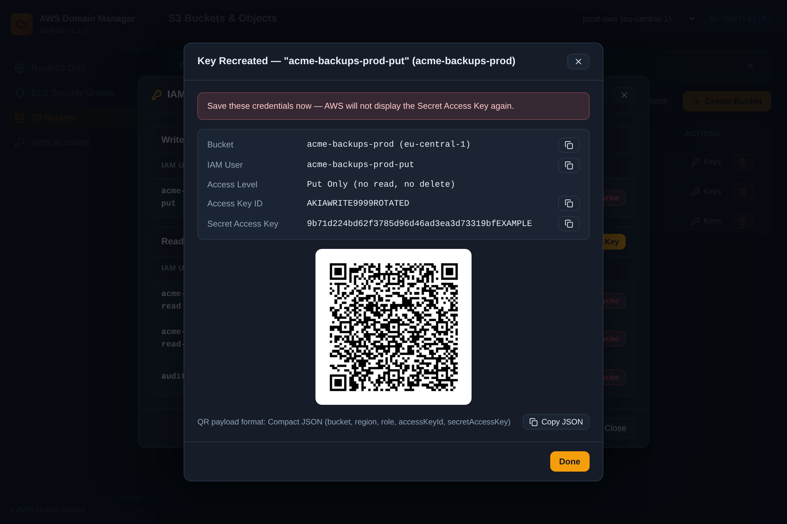
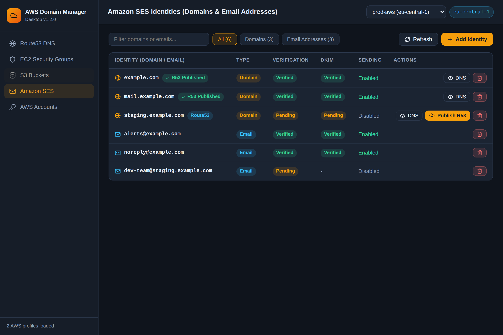
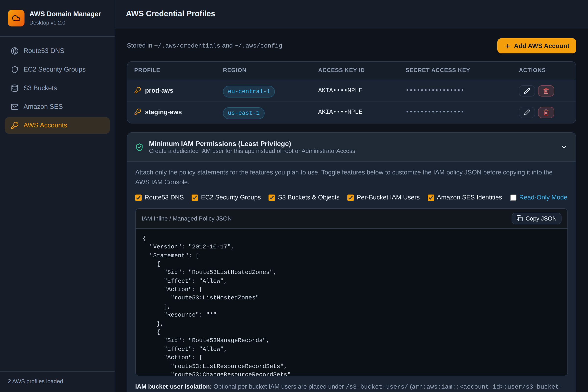
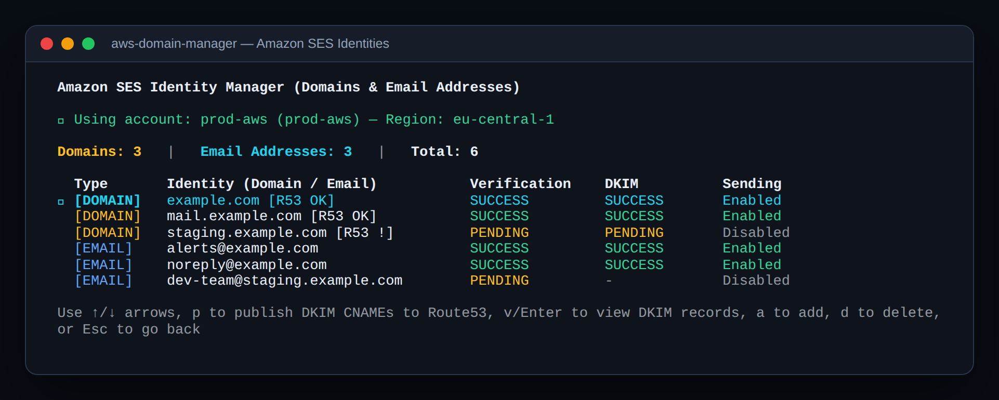

# AWS Domain Manager

[](https://github.com/sebseb7/awsDomainManager/actions/workflows/ci.yml)
[](https://github.com/sebseb7/awsDomainManager/actions/workflows/release.yml)

**Download Desktop App (v1.3.0):**
- **macOS (Apple Silicon `.dmg`):** [AWS Domain Manager_1.3.0_aarch64.dmg](https://github.com/sebseb7/awsDomainManager/releases/download/v4/AWS.Domain.Manager_1.3.0_aarch64.dmg)
- **Windows (x64 `.exe`):** [AWS Domain Manager_1.3.0_x64-setup.exe](https://github.com/sebseb7/awsDomainManager/releases/download/v4/AWS.Domain.Manager_1.3.0_x64-setup.exe)

A terminal-based and native desktop UI tool for managing AWS Route53, EC2 Security Groups, S3 Buckets (with scoped IAM key management), Amazon SES Identities (domains & email addresses), and AWS credential profiles across multiple accounts.

## Screenshots

### Desktop App (Tauri v2)

| Route53 DNS Records | EC2 Security Groups |
| :---: | :---: |
|  |  |

| S3 Bucket IAM Keys (Single Write + Multiple Read) | Recreated IAM Key & QR Code |
| :---: | :---: |
|  |  |

| Amazon SES Identities (Domains & Email Addresses) | AWS Accounts & Minimum IAM Permissions Guide |
| :---: | :---: |
|  |  |

### Terminal UI (TUI)

| Route53 DNS Records | S3 Bucket IAM Keys |
| :---: | :---: |
|  |  |

| Amazon SES Identities | Recreated IAM Key & Terminal QR Code |
| :---: | :---: |
|  |  |

> Screenshots are generated automatically with dummy data by running `npm test` (Playwright + Ink).

## Usage

### Desktop App (Tauri v2)

Download the pre-built macOS (`.dmg`) or Windows (`.exe`) installer from [GitHub Releases](https://github.com/sebseb7/awsDomainManager/releases), or run locally from source:

```bash
cd desktop && npm install && npm run tauri dev
```

### Terminal UI (CLI)

```bash
npm i . && npm run build && npm run start
```

## Features

- **Route53 DNS Records** — Manage A/AAAA/CNAME/MX/TXT/NS records across hosted zones
- **EC2 Security Groups** — View, add, and delete inbound rules for security groups
- **S3 Buckets** — List, create (with optional scoped Put-Only and/or Read-Only IAM user creation — never delete — plus a scannable QR code of bucket & credentials), and delete S3 buckets; manage per-bucket IAM keys (revoke/recreate read & write keys, multiple read keys allowed, max 1 write key per bucket); and browse prefixes/folders to upload, download, or delete objects
- **Amazon SES Identities & SMTP** — List, filter, add, and delete domain and email address identities with verification, DKIM, DMARC, inbound MX, and sending status:
  - Auto-detects matching Route53 hosted zones across all configured AWS accounts and publishes Easy DKIM `CNAME` and DMARC `TXT` (`_dmarc.<domain>`) records automatically or on demand
  - Offers optional region-aware SES inbound `MX` (`10 inbound-smtp.<region>.amazonaws.com`) publishing for domains (with overwrite warning if an existing MX record is present)
  - Highlights unverified email identities with an **Action required** inbox verification banner and one-click **Resend** verification email action
  - Manages multiple per-email **SMTP Sender Keys** (`AmazonSesSendingAccess` IAM users under `/ses-smtp-users/`, scoped to `ses:FromAddress`) with SigV4-derived SMTP passwords, rotation, revocation, and an integrated **SMTP Send Tester** (`lettre` in Desktop, `nodemailer` in TUI)
- **AWS Account Management** — Add, edit, and remove AWS credential profiles (`~/.aws/credentials` and `~/.aws/config`) directly from the tool, with an interactive **Minimum IAM Permissions** policy generator
- Terminal UI with keyboard navigation and native Desktop App (Tauri v2)

## Navigation

```
Resource Selection
  ├── Route53 Hosted Zones
  │     ├── Select account
  │     ├── Select hosted zone
  │     └── View/manage DNS records (a/A/c/m/t/n to add, d to delete)
  │
  ├── EC2 Security Groups
  │     ├── Select account
  │     ├── Select security group
  │     └── View/manage inbound rules (a to add, d to delete)
  │
  ├── S3 Buckets
  │     ├── Select account
  │     ├── View/create/delete buckets (a to create, k for IAM keys, d to delete, Enter to browse)
  │     ├── Manage per-bucket IAM keys (w write key, n/a read key, r recreate, d revoke)
  │     └── Browse/manage bucket objects (Enter to open folder, u to upload, g to download, k for IAM keys, d to delete)
  │
  ├── Amazon SES Identities
  │     ├── Select account
  │     ├── View/add/delete domains & emails (a add, v/Enter DNS, p publish DKIM/DMARC, m publish MX, r resend verification, k SMTP keys, d delete)
  │     └── Manage per-email SMTP Sender Keys (a/n add key, t SMTP send tester, r recreate, d revoke)
  │
  └── Manage AWS Accounts
        └── View/add/edit/remove AWS profiles (a to add, e/Enter to edit, d to remove)
```

### Key Bindings

| Key | Route53 Records | EC2 Rules | S3 Buckets / Objects | Amazon SES Identities | SES SMTP Keys | Manage AWS Accounts |
|-----|----------------|-----------|----------------------|-----------------------|---------------|---------------------|
| `↑/↓` | Navigate list | Navigate list | Navigate list | Navigate list | Navigate list | Navigate list |
| `Enter` | Select | Select | Browse bucket / folder | View DNS records | — | Edit selected account |
| `a` | Add A record | Add inbound rule | Create bucket | Add domain or email | Add sender key | Add AWS account |
| `A` | Add AAAA record | — | — | — | — | — |
| `c` | Add CNAME record | — | — | — | — | — |
| `e` | — | — | — | — | — | Edit selected account |
| `g` | — | — | Download file (objects) | — | — | — |
| `k` | — | — | Manage bucket IAM keys | Manage email SMTP keys | — | — |
| `m` | Add MX record | — | — | Publish inbound MX (domains) | — | — |
| `n` | Add NS record | — | Add read key (S3 keys) | — | Add sender key | — |
| `p` | — | — | — | Publish DKIM/DMARC to R53 | — | — |
| `r` | — | — | Recreate key (S3 keys) | Resend verification email | Recreate SMTP key | — |
| `t` | Add TXT record | — | — | — | Open SMTP send tester | — |
| `u` | — | — | Upload file (objects) | — | — | — |
| `v` | — | — | — | View DNS records | — | — |
| `d` | Delete selected | Delete selected rule | Delete / revoke | Delete identity | Revoke sender key | Remove selected account |
| `Esc` | Go back | Go back | Up folder / back | Go back | Back to SES identities | Go back |

## Requirements

- Node.js 18+
- AWS credentials configured in `~/.aws/credentials` (or add them via **Manage AWS Accounts**)
- AWS region configured in `~/.aws/config` (EC2, S3, and SES are region-specific)

## Minimum IAM Permissions (Least Privilege)

Create a dedicated IAM user for this tool instead of using root or `AdministratorAccess` credentials. The optimized policy below fits well under AWS's **2,048-character** inline user policy limit (~1,191 non-whitespace characters) — omit any actions or statements for services you do not use (or customize interactively in the Desktop App's **AWS Accounts** view):

```json
{
  "Version": "2012-10-17",
  "Statement": [
    {
      "Sid": "GlobalAndListActions",
      "Effect": "Allow",
      "Action": [
        "route53:ListHostedZones",
        "ec2:DescribeSecurityGroups",
        "ec2:DescribeSecurityGroupRules",
        "ec2:AuthorizeSecurityGroupIngress",
        "ec2:RevokeSecurityGroupIngress",
        "s3:ListAllMyBuckets",
        "iam:ListUsers",
        "ses:ListEmailIdentities",
        "ses:GetEmailIdentity",
        "ses:CreateEmailIdentity",
        "ses:DeleteEmailIdentity"
      ],
      "Resource": "*"
    },
    {
      "Sid": "Route53Records",
      "Effect": "Allow",
      "Action": [
        "route53:ListResourceRecordSets",
        "route53:ChangeResourceRecordSets"
      ],
      "Resource": "arn:aws:route53:::hostedzone/*"
    },
    {
      "Sid": "S3BucketsAndObjects",
      "Effect": "Allow",
      "Action": [
        "s3:CreateBucket",
        "s3:DeleteBucket",
        "s3:GetBucketLocation",
        "s3:ListBucket",
        "s3:GetObject",
        "s3:PutObject",
        "s3:DeleteObject"
      ],
      "Resource": [
        "arn:aws:s3:::*",
        "arn:aws:s3:::*/*"
      ]
    },
    {
      "Sid": "IAMScopedUsersOnly",
      "Effect": "Allow",
      "Action": [
        "iam:GetUser",
        "iam:ListUserTags",
        "iam:CreateUser",
        "iam:DeleteUser",
        "iam:TagUser",
        "iam:PutUserPolicy",
        "iam:ListUserPolicies",
        "iam:DeleteUserPolicy",
        "iam:CreateAccessKey",
        "iam:ListAccessKeys",
        "iam:DeleteAccessKey",
        "iam:GetAccessKeyLastUsed"
      ],
      "Resource": [
        "arn:aws:iam::*:user/s3-bucket-users/*",
        "arn:aws:iam::*:user/ses-smtp-users/*"
      ]
    }
  ]
}
```

### Locking down permissions further

- **IAM user isolation**: Optional per-bucket S3 users are placed under `/s3-bucket-users/` (`arn:aws:iam::<account-id>:user/s3-bucket-users/*`) and per-email SES SMTP sender users under `/ses-smtp-users/` (`arn:aws:iam::<account-id>:user/ses-smtp-users/*`). The `IAMScopedUsersOnly` statement ensures this tool's management user cannot modify any other IAM users in your account. Omit it (and `iam:ListUsers`) if you don't manage per-bucket or per-email IAM keys.
- **Scoped Route53 / S3 resources**: Replace `arn:aws:route53:::hostedzone/*` with specific hosted zone IDs, or `arn:aws:s3:::*` with specific bucket name patterns (e.g. `arn:aws:s3:::my-prefix-*`).
- **Read-only usage**: Remove write actions (`ChangeResourceRecordSets`, `AuthorizeSecurityGroupIngress`, `RevokeSecurityGroupIngress`, `CreateBucket`, `DeleteBucket`, `PutObject`, `DeleteObject`, `CreateEmailIdentity`, `DeleteEmailIdentity`, `iam:ListUsers`) and the `IAMScopedUsersOnly` statement if you only need read/view access.
